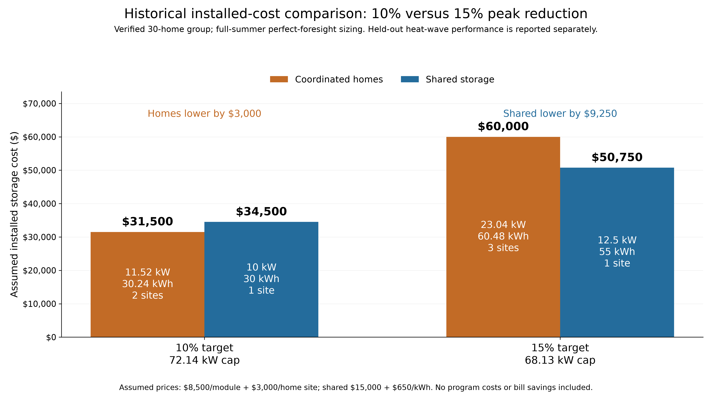

# PeakShare · One battery, thirty homes

PeakShare explores a practical question for Avangrid: can one shared battery
reduce a group of homes' busiest-hour electricity demand at a lower installed
cost than batteries at individual homes? ClearGrid is the Python analysis
behind the project.

In the verified 30-home historical case, both designs achieve the same 15%
peak-reduction target. The shared battery costs **$50,750**, compared with
**$60,000** for batteries at three homes, using the study's assumed prices.
That is **$9,250 less**, or **15.4% lower installed cost**.



## What the project does

The tool reads hourly electricity use and weather to identify customers for
managed vehicle charging, thermostat outreach, home battery assessment and
solar export checks. It then compares battery designs against the same demand
limit, accounting for available stored energy, charging losses and recharge.

The analysis screens **33,674 qualified meters**. Storage comparisons use
synthetic groups formed from real household profiles. The data covers
September 2025 through August 2026.

## Main findings

| Question | Result |
|---|---|
| What peak must the showcase address? | 80.153 kW on July 3, reduced to a 68.130 kW target. |
| What does the shared design require? | One site, 12.5 kW of power and 55 kWh of stored energy. |
| What does the home alternative require? | Six modules at three sites, 23.04 kW and 60.48 kWh. |
| Does shared storage always cost less? | Homes cost less at the 10% target. Shared storage costs less at 15%. |
| Does the result extend beyond one group? | Five shared wins and one tie across six additional groups after refinement. |
| Can managed charging reduce the battery need? | The tested scenario moves 19.279 kWh but leaves the July 3 sizing event and equipment sizes unchanged. |

The proposed next step is a utility pilot assessment using verified customer
participation, a physical site study and installed quotes. Reported costs are
scenario assumptions. Historical model performance and future field
performance have different evidence requirements.

## Explore the work

| Resource | Contents |
|---|---|
| [Project guide](deck/PROJECT_GUIDE.md) | Plain-language explanation of the approach and customer programs. |
| [Results and methods](docs/DECISION_EVIDENCE.md) | Detailed cost comparisons, customer priorities and supporting analysis. |
| [Figures and data](deck/README.md) | Published charts, captions and downloadable aggregate data. |
| [Challenge criteria](docs/RUBRIC_ALIGNMENT.md) | How the submission addresses each grading category. |
| [Run instructions](docs/RUNBOOK.md) | Dependencies, authorized local data setup and commands. |
| [Code guide](src/README.md) | Analysis modules and their responsibilities. |
| [Submission guide](docs/SUBMISSION.md) | Code and presentation deliverables. |

## Run the checks

Use 64-bit Python 3.12. From the repository root in PowerShell:

```powershell
python -m venv .venv
.\.venv\Scripts\python.exe -m pip install -r requirements-lock.txt
.\.venv\Scripts\python.exe -m unittest discover -s src -p "test_*.py" -v
```

The 31 checks use small, hand-computable cases and run without organizer data.
They cover battery limits, energy conservation, recharge across midnight,
customer demand timing and cost comparisons.

To reproduce the full analysis, follow the [runbook](docs/RUNBOOK.md).
After completing its data preparation and analysis stages, run:

```powershell
.\.venv\Scripts\python.exe src/finalize.py --reuse-input-audit
```

This verifies recorded input hashes, runs the checks, refreshes aggregate
evidence and packages the submission locally.

## Evidence and scope

Customer screening identifies candidates for confirmation. Held-out reference
recovery is 17 of 90 likely EV homes in the top 1,000 and 4 of 43 heat-pump
references in the top 500. Unlisted appliance status remains unknown.

The showcase uses 2,184 complete summer hours, excluding 24 missing hours.
Smaller batteries sized without July 1–4 miss the demand limit during that
period. Larger designs sized with the full historical record pass the same
replay. These tests support an engineering assessment and a future field pilot.

Organizer inputs, meter identifiers and household-level outputs remain in
authorized local storage. This repository provides code, methods and aggregate
evidence. Actual customer bill savings and avoided network investment require
tariffs, site information and operating measurements.

## Repository layout

```text
src/       Analysis, figure generation and verification
config/    Fixed screening rules, experiment plans and empty ID templates
deck/      Aggregate figures and supporting data
docs/      Methods, results, run instructions and challenge coverage
data/      Authorized local inputs and outputs, excluded from Git
```
